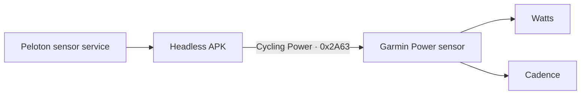

# PeloPower

Ride with the Peloton screen you already use and record watts and cadence together on Garmin.
PeloPower reads the bike’s sensors in the background and sends both measurements through one
Bluetooth Power sensor pairing. The tested setup used a G700 Cross Training Bike+, Android 13,
Affernet 3.4.1, and the bike’s built-in radio.

**[Download the headless APK](https://github.com/cmiami/pelopower/releases/latest/download/pelopower-headless.apk)** · [Releases and checksums](https://github.com/cmiami/pelopower/releases) · [Garmin pairing](#pair-a-garmin)

## Install on the bike

Use a computer with Android SDK Platform Tools (`adb`) and an authorized USB or wireless
debugging connection to the tablet. For wireless pairing on Android 13, see the
[ADB connection steps](docs/DISCOVERY.md#1-establish-adb-access).

1. Download **pelopower-headless.apk** and **install-headless.sh** from the [latest release](https://github.com/cmiami/pelopower/releases/latest) into the same directory.
2. Open Bash in that directory and run the following commands. The bike should appear as `device` in the first command’s output.

   ```bash
   adb devices -l
   bash install-headless.sh ./pelopower-headless.apk
   ```

   If ADB lists multiple devices, set `ADB_SERIAL` to the bike’s serial or connection endpoint before running the installer.
3. The installer grants Bluetooth permissions and starts the service. The headless APK has no launcher icon and starts again when Android boots.

## Releases

| Download | Use |
| --- | --- |
| [Headless APK](https://github.com/cmiami/pelopower/releases/latest/download/pelopower-headless.apk) | Install on the Peloton tablet. |
| [Installer](https://github.com/cmiami/pelopower/releases/latest/download/install-headless.sh) | Run on the computer connected to the bike. |
| [Public-address advertiser](https://github.com/cmiami/pelopower/releases/latest/download/public-cps-probe.jar) | Optional pairing helper used in the successful Garmin test. |

## Pair a Garmin

1. [Install the headless APK](#install-on-the-bike). It starts automatically after installation and boot.
2. On the Garmin, open **Sensors & Accessories → Add New → Power** and select **PeloPower**.
3. If the watch cannot find or pair with the sensor, start the [public-address advertiser](tools/android-public-advertiser/README.md) through ADB and repeat the search. This helper was running during the successful G700 test.
4. Start an Indoor Bike activity with power and cadence data fields and pedal. Both readings share the same subscription.

The APK stays discoverable between rides and pauses measurement notifications after 30 seconds
without movement. The helper runs until the tablet reboots or its process stops. Reconnection
after reboot using the APK alone still needs testing. If the tablet only dims when idle, check
**Developer options → Stay awake**. Turning that setting off allowed the tested tablet's configured
display timeout to apply.


## How the ride reaches your watch



## Repository shape

- `CyclingPowerGattServer`: dependency-free Android GATT server advertising Cycling Power Service
  `0x1818` and exposing Cycling Speed and Cadence Service `0x1816`. Cadence and speed are present as crank
  and wheel revolution data in both profiles for broad receiver compatibility.
- `UsbBleBridge`: direct Android USB-host transport for the external nRF52840 BLE radio. It runs in
  parallel with the built-in-radio path, so one APK works on affected and unaffected bikes.
- `firmware/nrf52840-dongle`: Zephyr firmware that owns BLE advertising, CPS, CSCS, the CSC control
  point, Garmin connections, and notifications without using the Peloton Bluetooth controller.
- `PowerSource`: the decoder boundary.
- `PelotonPowerSource`: read-only Bike+/G700 polling adapter for the Affernet `IBikeInterface`.
- `PelotonV1PowerSource`: callback adapter selected automatically on original Peloton Bike models.
- `LegacyServiceProbe`: verifies the older Bike+ service package/action/descriptor without issuing
  a command.
- `RawBinderSnapshotProbe`: debug-only read snapshot of the known legacy transaction for offline
  correlation.
- `WorkoutGate`: movement-based transmitting state.
- `BootReceiver` + `BridgeService`: automatic foreground startup and continuous readiness.
- `BootstrapActivity`: a no-window, no-launcher entry point used once by the headless installer.
- `scripts/`: read-only ADB inventory, workout log capture, install, and probe retrieval.

## Build

Requirements: JDK 17+ and Android SDK 36.

```bash
export ANDROID_HOME=/home/user/android-sdk
./gradlew testDebugUnitTest assembleDebug assembleHeadless
```

The debug APK is `app/build/outputs/apk/debug/app-debug.apk`. It includes diagnostics, test-power
buttons, and raw Binder capture. The signed, minified headless APK is
`app/build/outputs/apk/headless/app-headless.apk`; it has no launcher icon or visible activity.
The install scripts stop the other flavor first because Android permits only one owner for the
standard cycling GATT services. The debug flavor does not auto-start at boot.
The headless flavor uses the Android debug signing key for convenient private sideloading. Configure
a private release signing key before distributing the APK beyond bikes you manage.

## Headless operation

The discovery UI exists only in the debug build. The normal bike-side build runs as a foreground
service with no app window or launcher icon, starts once during installation, and restarts from
`BOOT_COMPLETED` after subsequent tablet boots:

```bash
./gradlew assembleHeadless
./scripts/install-headless.sh
```

"Foreground" is Android lifecycle terminology: no app screen stays open. On Android 13+, the
installer intentionally does not grant notification permission, so the service is listed in Android's
active-app Task Manager without placing an ongoing item in the notification drawer. On older Android
versions, the OS may show a silent ongoing notification. Force-stopping the package disables
automatic boot delivery until the installer/bootstrap component is invoked again.
The installer grants the two required Bluetooth permissions through ADB, so a successful headless
install does not display a Bluetooth or location prompt. Location and scan permission are not used.
An external USB radio needs Android's separate one-time USB-device approval. Accepting the attach
dialog makes PeloPower the handler and grants access until disconnection; the app reconnects to the
dongle automatically after service or tablet restarts.

## Sideload and discovery

See [docs/DISCOVERY.md](docs/DISCOVERY.md). The short path is:

```bash
adb devices -l
export ADB_SERIAL=192.168.1.100:PORT
./scripts/probe-bike.sh
./scripts/install-debug.sh
adb logcat -s PeloPower
```

## USB BLE radio workaround

A normal PC Bluetooth 5.x dongle will enumerate on the G700, but it will not automatically become a
second Android `BluetoothAdapter`. This image exposes one vendor HAL and binds its internal USB
controller through MediaTek's `btmtk_usb_unify` driver rather than a generic USB Bluetooth path.
Replacing the Android Bluetooth framework would require root/system-image changes.

The supported bypass is a [Nordic nRF52840 Dongle](https://www.nordicsemi.com/Products/Development-hardware/nrf52840-dongle),
which is itself a USB-powered Bluetooth 5 radio with native USB and an integrated antenna. PeloPower
puts the GATT server on that radio and uses Android's supported USB-host API only as a metric cable:

```text
Peloton sensor service -> PeloPower APK -> USB CDC -> nRF52840 -> BLE CPS/CSCS -> Garmin
```

Build and flash it with the instructions in
[`firmware/nrf52840-dongle/README.md`](firmware/nrf52840-dongle/README.md), or program the packaged
`firmware/nrf52840-dongle/artifacts/pelopower-nrf52840-dongle-1.0.0.hex` using Nordic's nRF Connect
Programmer. Plug it
into a bike USB host port (use the appropriate OTG adapter if the exposed connector is USB-C),
accept the one-time Android USB prompt, and search the Garmin for `PeloPower` as both a power sensor
and a speed/cadence sensor. No Peloton workout or pedaling is needed for discovery.

The firmware advertises continuously at +8 dBm, exposes Cycling Power `0x1818` and Cycling Speed and
Cadence `0x1816`, uses the standard Cycling Power Sensor appearance, supports Garmin's CSC cumulative
wheel setup procedure, and retains a stable BLE identity across power cycles. It reports idle zeros
when the APK is absent or USB data is stale. This path still needs a physical nRF52840/Garmin test;
the checked-in firmware has been compiled for the exact dongle target but cannot be RF-tested without
the dongle.

## BLE behavior

The headless APK advertises a single Cycling Power sensor at a balanced interval, including
while idle for pairing. Pair it as a Power sensor to receive watts and crank cadence together.
The separate CSC service is available after connection. Android BLE measurements pause
between workouts. The bridge requests no display wake lock and uses the tablet's display timeout.
Once the power source produces three moving samples (about 400 ms on Bike+/G700), it notifies
instantaneous power, cadence, and virtual-wheel speed; after 30 seconds without movement it sends
a final zero measurement and returns to waiting.

Power, cadence, and speed are in scope. FTMS, ERG/SIM control, ANT+, ride recording, and resistance
writes remain out of scope for this small sensor bridge.

BLE cycling profiles represent speed as cumulative wheel revolutions rather than instantaneous
km/h. PeloPower uses a virtual wheel circumference of **2096 mm**. Configure the receiving device
to that wheel size (manual rather than automatic calibration) so its derived speed matches the bike.
The BikeData contract exposes centiwatts and RPM. PeloPower derives Peloton-style speed from power
using the established display curve and converts it to cumulative wheel revolutions for BLE.

## Safety and support boundary

This project is unaffiliated with Peloton and depends on undocumented interfaces that an OTA update
can change. The discovery path performs read-only service binding and capture. It does not root the
tablet, modify system packages, write resistance, bypass a membership, or contact Peloton services.
